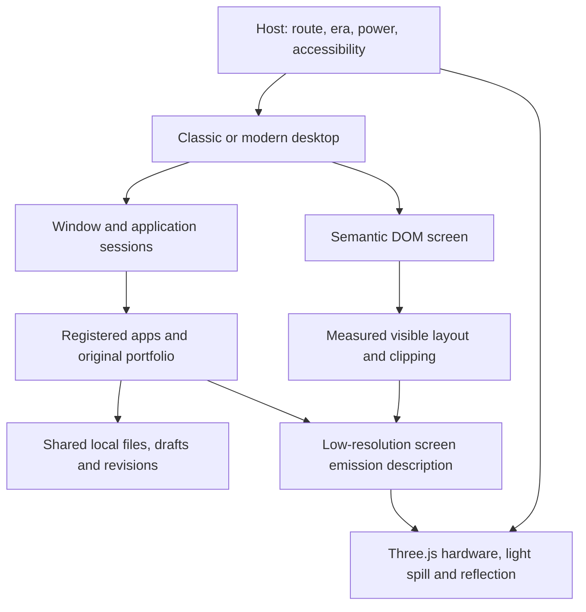

# Rowan engineering and release contract

Companion to [OS_DESIGN.md](../OS_DESIGN.md) · 31 October 2026 · Specification, not an implementation report

## Existing code and migration boundary

The repository currently runs Vite, React 18, strict TypeScript for the newer monitor layer, Three.js, Framer Motion, GSAP, and the existing Supabase-backed portfolio. Reuse these. A new rendering framework, global state library, backend, or native emulator is not required to create the specified experience.

| Existing area | Responsibility in the new build |
| --- | --- |
| `src/App.tsx`, `Room`, `Monitor`, `Bezel`, `Screen` | Host entry, era selection, physical presentation, and display lifecycle; refactor their responsibilities deliberately |
| `src/components/MonitorChassis.jsx`, `src/lib/monitorChassis.js` | Existing 3D geometry/resource-lifetime reference; not the completed new renderer |
| `src/styles/monitor.css`, `screen.css`, `crt-edges.css` | Current material/optical reference and intentional low-graphics fallback |
| `src/components/PortfolioScreen.tsx`, `src/PortfolioMain.jsx` | Original portfolio application; keep one mounted content provider and scoped styles |
| `src/store/useMonitor.ts` | Separate hardware power/display state from desktop/window state; preserve meaningful saved preferences |
| `src/hooks/useKeyboardRemote.ts` | Replace globally intercepted letter/arrow shortcuts with context-aware dispatch |
| `src/context/PortfolioContext.jsx`, admin, recovery/save helpers | Preserve the published portfolio/CMS boundary and existing recovery behavior |
| `src/audio/sfx.ts`, story components/data | Reuse opt-in audio lifecycle and Transmission; adapt, do not create parallel players |
| Existing tests and SPA rewrites | Retain coverage and verify new app links alongside original routes |

The older chassis implementation uses fixed lighting and a different DOM aperture (`.crt-screen`). It cannot simply be mounted over the newer `.screen` tree. It also contains a light-colored material, unlike the current charcoal CSS finish. Resolve aperture measurements, material colors, resize behavior, and cleanup before reusing it. Keep its useful mesh/disposal patterns rather than its old assumptions.

Do not replace the working portfolio with text copied into OS windows. Give it a real application adapter and its own scroll root; ensure GSAP/Lenis measure the app viewport when the window changes size, maximizes, restores, or switches era.

## A small shared core

Use one app registry and one desktop state model, with distinct classic and modern shell presenters. Share file operations, app sessions, and application logic. Share semantic controls where useful; do not force both shell layouts through the same DOM skeleton with different colors.

State boundaries:

- **Hardware:** era, power phase, brightness, display color mode, scene preset, sound consent, graphics quality. Store CRT-only settings under the CRT profile.
- **Desktop:** active window, z-order, bounds, minimized/maximized state, modern pair membership, workspace assignment. Save separately per era.
- **Application:** open document/media IDs, selections, dirty drafts, file association. Keep data independent of window geometry and shell unmounting.
- **Files:** canonical IDs, parent IDs, names, MIME types, timestamps, blob/text data, revisions, and Trash origin. User-visible drive/path syntax is an adapter.
- **Published content:** existing portfolio provider and backend. It is not the visitor's writable filesystem.
- **Presentation:** overview, preparing, approaching, handoff, focused, or returning; selected destination, camera progress, and readiness/failure. Keep this separate from file/app state so a cancelled camera move cannot delete a document.

Window bounds use aperture CSS pixels. Clamp them against the current usable area and per-app minimum sizes. On compact layouts, retain desktop bounds for later restoration rather than overwriting them with full-screen phone bounds. Reserve taskbar/rail/status and host-selector areas before placement.

## Window behavior and input

Use pointer capture for dragging/resizing. Escape cancels a pending drag; pointer cancellation releases capture and clears previews. Update transforms during drag without publishing a full app-tree render every pointer event; commit final bounds to the store afterward. Keep hit testing and keyboard focus in normal DOM coordinates.

Model a joined pair as two window IDs, an orientation, and a split ratio. Derive bounds from the shared rectangle and app minimum sizes. Close or detach one member without corrupting the other. Never infer pair membership solely from coincident pixel positions.

Desktop hotkeys are scoped to the active app and editing state. The current global `p`, `c`, `s`, digits, and arrow bindings would interfere with files, editors, and terminals; they must not remain active there. Browser/host-reserved shortcuts are not reliable OS bindings. Preserve normal browser navigation/zoom and expose menu/button equivalents for everything.

Minimum keyboard workflows: Tab through host/app controls, Enter to open an item, arrows within menus/lists, Escape to dismiss the current transient surface, F2 for selected-file rename, Shift+F10 for a context menu, and Ctrl/Cmd+S inside the editor. Do not globally prevent default for unhandled keys. An unsaved-changes dialog takes priority over era/navigation shortcuts.

## Routing and era changes

Proposed canonical desktop routes are `/os/98` and `/os/26`, with optional app/object query parameters. Parse and validate them centrally. Use stable object IDs for deep links; display paths can change after a rename.

- `/` without a legacy section hash opens the two-computer overview and chooser. The previous era may be highlighted; it does not automatically skip the choice.
- Explicit `/os/98` and `/os/26` routes enter the requested focused desktop without requiring the overview. Commit a normal chooser selection to its canonical OS URL when entry completes; do not add history entries on every camera frame.
- Existing `/#home`, `/#work`, `/#about`, `/#services`, and contact links open the portfolio app at the intended section. Preserve existing story links through the Transmission entry.
- Existing `/work/:id` opens the real project detail app in the requested/restored era. Unknown IDs get a useful not-found state.
- Existing `/admin` and `#admin` retain the current admin experience and authorization checks, outside the guest OS.
- Browser Back/Forward restores navigational location and focus. Moving/minimizing windows does not push URL entries.

Switch sequence: capture drafts and layout → persist or retain a recoverable in-memory snapshot → load destination shell/graphics → swap the active era → restore valid window state → release outgoing GPU resources and media. An ordinary switch never discards edits. If saving and recovery both fail, keep the editor and offer export/retry before leaving it. Ignore obsolete async completions using an era-transition generation ID.

## Opening scene, camera approach, and screen handoff

Implement the newly confirmed opening as one physical scene with the charcoal CRT workstation on the left and SA-02 workstation on the right, with the later user direction removing desks, tables, stands, and peripheral props. The two monitor bodies remain the focus. A shared WebGL renderer draws both objects; this does not justify mounting two OS/app trees or creating separate competing render loops. The overview can use lower-detail hardware and lightweight readonly screen previews. Reserve high-detail assets for the destination that needs them. The preview is not an interactive desktop.

Retain the reusable low-detail overview resources when focusing a monitor; release superseded high-detail/app-specific resources rather than tearing down the entire shared scene on every switch. Apply the scene draw-call/triangle budget to everything visible in the overview combined.

The existing focused-monitor concept images remain close-up references, not the composition of this opening scene. The old current CSS monitor-arrival slide is not the specified camera move.

### State and readiness

Use the presentation state machine `overview → preparing → approaching → handoff → focused`; `focused → returning → overview` handles the visible Change computer route. The chooser's open/closed state is separate. Explicit deep links and Skip animation take a direct path through readiness to focused. Preparation can fail back to the chooser while preserving the outgoing saved app state.

The readiness gate includes the selected shell's essential code, fonts, final aperture layout, preview/handoff textures, destination geometry, and warmed required shaders. It does not wait for every app or a remote CMS request. Show truthful Opening/Retry feedback in the chooser if preparation takes time. Do not start the flight and stall halfway while compiling a shader or importing a module. Preload on deliberate focus/hover when helpful; avoid fetching every app for both eras on arrival.

Only one request owns a transition. During preparation the destination can change; once in flight, repeated choice input is ignored or explicitly queued for after the safe endpoint. Escape cancels back along a continuous path to the overview, or immediately through the reduced-motion route. Never replace one running timeline with another that starts from a different camera pose. Hidden-tab suspension pauses the presentation clock so returning cannot jump across the whole sequence.

### Camera and choreography

Use the existing animation stack with one presentation clock. Advance camera/object uniforms in the render loop, not by publishing React state on every frame. Compute progress from elapsed time rather than frame counts. Use a real 3D dolly path with smooth acceleration/deceleration and continuous position/orientation derivatives; use a stable look direction that settles on the chosen screen normal. Keep field of view stable unless a separately reviewed lens change is demonstrably necessary. No fixed-increment motion, spring overshoot, or screenshot-scale substitution.

Keep one compatible camera projection from overview to the frontal endpoint; do not switch from perspective to orthographic on the handoff frame. The endpoint is derived from the measured target monitor/aperture, available CSS viewport, and safe areas, rather than magic desktop coordinates. The other monitor naturally leaves the frustum as the selected face fills it. At the endpoint, the existing focused hardware framing and controls remain visible.

The current choreography uses a 420ms choice acknowledgment, one uninterrupted 1.8-second camera approach, and a 420ms live-screen reveal. Fade the preview into an era-matched solid surface during the last third of travel. The DOM begins with the same surface and fades it away only after alignment. The return is a continuous 900ms pull-back. Sound stays opt-in; movement must not depend on an autoplay audio track.

### Seamless does not mean a fake DOM texture

The selected OS shell may prepare in a noninteractive staging root at its final dimensions, but must remain out of the accessibility/focus tree until visible. Do not reflow the real desktop to each tiny projected screen size along the approach. At the final alignment, move the prepared tree into its live aperture without remounting its editor/app state.

The coarse emission buffer described below is sufficient for blurred lighting; it is not a pixel-accurate texture of arbitrary DOM. Do not stretch it into a detailed desktop during the last close-up. Use an intentional **matched handoff surface** when an exact current desktop preview is unavailable: during the approach, the screen enters an era-appropriate solid teal/mineral surface with a small Rowan mark; the DOM presents the identical surface over the restored desktop. Once the camera aligns, crossfade the GPU surface to that matching DOM surface within the screen mask, then reveal the live app layer during the final settle. This avoids changing unreadable preview apps into unrelated live windows on the seam frame. It must not be a black/white flash or a fake loading percentage.

For any approved app-specific exact preview alternative, show evidence that it matches the DOM's current state, font metrics, clipping, cursor, and color transform. Do not introduce continuous HTML screenshot capture, host screen-capture permissions, or a new renderer merely to hide the seam.

Pass the same screen corner projection, glass contour/mask, exposure/brightness, and display state to the hardware, preview, and DOM optical layer. Freeze any time-sensitive preview detail during the short blend. Keep reflections anchored to the object while the camera moves; never reset the glass highlight as the DOM takes over. Remove the preview once it is fully covered and enable pointer/focus input only after registration is complete. Focus the desktop/app root, not an arbitrary field that would open the phone keyboard.

At 100% browser zoom, use a ≤1 CSS-pixel endpoint registration target for the aperture corners and center. Verify at 200% zoom and supported device pixel ratios too. Resize/orientation change during the move must rebase continuously from the current pose or finish through the direct fade into a newly measured endpoint. Never keep flying toward stale screen coordinates. Context loss, failed readiness, or an invalid aperture resolves to the functional direct-entry fallback, not an indefinitely blocked overlay.

### 60fps transition budget

The user's target applies to the cinematic camera sequence, including the final DOM blend. On a 60Hz display, budget about 16.67ms per frame. Warm required resources first; avoid per-frame DOM layout reads, asset creation, synchronous GPU readback, and expensive full-screen blur. Cache the aperture until a real resize invalidates it. Render the scene once per frame through the shared renderer; freeze nonselected preview/media work.

On agreed desktop and mobile reference devices, record warmed entry/return traces with both choices. Initial acceptance targets: average ≥58fps on a 60Hz display, at least 95% of frame intervals ≤18.5ms, and no transition-induced frame interval >50ms. Record handoff frames separately because a smooth camera followed by a stalled DOM activation is a failure. Hidden/background periods are not part of the foreground measurement. These values are test targets, not measurements of current code.

Start with the lower-detail two-monitor scene, capped DPR, modest environment resolution, and limited dynamic shadow/reflection work. If the device cannot sustain the approach, simplify graphics before changing motion. Keep Skip animation and reduced motion as intentional quick-fade alternatives. A lower-quality or 30fps fallback is not evidence that the 60fps cinematic target passed. Provide an optimized still of the same overview as the immediate loading/WebGL-unavailable presentation so the chooser remains useful while graphics initialize.

## Games and render lifecycle

`src/os/games/logic.js` defines the two six-game catalogs and pure puzzle/grid operations. `arcade.js` holds the fixed-size Pong/Breakout simulation; its timestep is capped. `Games.jsx` owns the edition-specific library and session rounds, with canvas drawing isolated in `Arcade.jsx`. Lazy-load this application through the existing app registry. Register `games` for routing, terminal launch, window titles, classic shortcuts, Start and the modern rail.

Use native buttons, DOM/SVG puzzle boards, canvas only for the continuous arcade field, and explicit mobile controls. Keyboard handlers belong to the game, not a global desktop listener. Pause timers and animation when inactive/minimized/powered off or document-hidden; clean up every interval, timeout, and frame request on game reset or close. Ignore reverse Snake input within one tick; a 2048 tile merges only once per move; generate Fifteen and Lights through legal moves so every new puzzle is solvable. Mines must protect the first click and its neighboring cells.

Automated checks cover catalog separation, mine safety/flood-fill, Snake collisions, Fifteen parity, merge scoring/directions, light toggles, constellation edge rules, orbit angle wrapping, arcade scoring/collisions, and curved-display window bounds. Browser checks still need to exercise the actual controls and responsive viewport. No public or persistent high scores are currently implemented.

## Local files, persistence, and recovery

Use IndexedDB for structured records, file blobs, and drafts. Use localStorage only for small settings where failure is already handled. Both shells and both terminal syntaxes address the same records. Do not duplicate files for each era.

Save files and revisions transactionally. Separate Save acknowledgment from optimistic UI: “Saved” means the transaction completed. Maintain recoverable editor drafts, and validate/migrate the stored schema without silently replacing older data. Recover a draft in an explicit state if it differs from the saved revision.

Multiple tabs can edit the same workspace. Use revision checks in the write transaction; a stale editor offers Keep both/Reload instead of silently replacing newer content. Notify other open tabs when a revision changes. Closing a window must not cancel an already accepted file write.

The starting workspace contains readonly links to published portfolio/project content and a writable Documents folder. Import makes a local copy; export creates a download. Recycle Bin is reversible until explicitly emptied. Reset settings and Clear local workspace are different actions; neither clears admin credentials, portfolio recovery drafts, or unrelated origin storage.

Reject invalid names and unsupported/oversize imports with actionable feedback. Define initial limits in one place: 5 MiB text, 20 MiB image, 100 MiB individual media file, and a 250 MiB application workspace soft limit, subject to the browser's smaller available quota. Decode images with pixel-count limits, not only compressed file size. Validate imported workspace archives, schemas, and paths before committing; reject traversal and active HTML/script content. Render text as text, not executable HTML. Import collisions offer explicit rename/replace/cancel with recovery.

Browser storage is subject to quota, availability, and possible eviction; private sessions may be temporary. Provide an export backup path, show actual save failure, and request persistent storage where appropriate without promising it will be granted. These limits are documented by [MDN's storage guidance](https://developer.mozilla.org/en-US/docs/Web/API/Storage_API/Storage_quotas_and_eviction_criteria). Storage denial falls back to a clearly labeled temporary in-memory workspace, with export and intact app operation.

Offline core apps must work after their assets have been cached. Add a narrowly scoped, versioned app-asset cache for this desktop; exclude admin/authenticated responses and avoid presenting stale CMS data as freshly fetched. Publish a new cache only after its complete manifest is available, retain the running client until it can safely update, and show retry/stale states for network content. The first visit still requires a connection.

The command parser accepts a documented bounded grammar: commands, quoted arguments, and the specified text redirection. Normalize both path syntaxes into canonical file IDs. Never use `eval`, `new Function`, arbitrary shell execution, or arbitrary proxy requests. Calculator and Run use their own constrained parsers/registry lookup. A fake in-OS browser cannot embed arbitrary websites under the project's no-iframe constraint; internal pages render locally, and external URLs use an explicit new-tab action.

## Rendering architecture: DOM interaction with real 3D hardware

Use the installed Three.js renderer and a frontal camera for the interactive focused view. Match its aperture to a measured DOM rectangle. Keep the readable app surface as ordinary React DOM; use WebGL for casing, glass/reflection surfaces, and illumination. Decorative layers do not consume clicks or keyboard focus.

Do not put a full-screen transparent WebGL clear pass over DOM and expect its transmission shader to see that DOM. GPU render targets cannot automatically contain browser-composited HTML. Likewise, Three.js CSS3DRenderer does not give DOM Three.js materials and documents a 100% zoom limitation, so it is not the default solution for this zoom-accessible product. See [the CSS3DRenderer limitations](https://threejs.org/docs/pages/CSS3DRenderer.html).

The primary compositor therefore uses:

1. A hardware canvas behind/around the DOM aperture, with real geometry and recessed surfaces.
2. The semantic DOM screen at a calibrated image plane.
3. A pointer-transparent front optical layer for glass reflections and restrained CRT edge treatment. Share the same camera/aperture geometry and masks; do not let the front pass repaint the hardware or darken the screen twice.

Frontal interaction avoids mismatched projected input. Do not introduce a free-orbit camera into the working desktop. Any optional presentation movement must keep DOM and hardware registered; if that cannot be demonstrated at browser zoom and resize, omit the movement, not the usable interface. Calibrate masks against actual element bounds after font loading and resize. Test the four screen corners and center for clipping and pointer agreement.

### Content-driven light and reflections

Build a small **screen emission description**, not a continuous DOM screenshot service. Each app supplies visible regions from its actual view model: solid areas, window rectangles, image/video sources where permitted, and coarse text coverage. Combine these in final z-order with measured visible bounds, clipping, wallpaper, and opacity. Occluded windows cannot keep lighting the frame.

Render that description into a low-resolution buffer, initially 256×144 for wide apertures, adapting aspect ratio to the real screen. Use the same loaded image/media resources as the app when their origin permits canvas use; no duplicate downloads. The original portfolio gets an adapter for visible background sections, media, and primary surfaces. Unavailable/tainted media receives a defined local neutral substitute in the light buffer, not an illegal readback or made-up dominant color. Update on layout/content changes and at a capped cadence during media/drag.

This buffer is an explicit approximation of emitted radiance, not an exact raster of arbitrary DOM. Matte color spill and blurred screen reflection can use it convincingly. Recognizable detailed screen reflections require a sufficiently faithful source adapter and must be proven in review; a coarse region map cannot be advertised as an exact reflected desktop. Never use screenshots of private host windows or request screen-capture permission for this effect.

Keep three effects separate:

| Effect | Required method |
| --- | --- |
| Diffuse spill on inner casing | Sample the emission buffer spatially, through a calibrated screen-to-surface transport/shader that includes distance, direction, surface normals, and visibility; do not replace it with one global accent light |
| Specular screen reflection on glossy lip/chamfer | Sample the buffer through reflected screen-plane UV coordinates with roughness-dependent filtering and Fresnel weighting; clip rays that do not intersect the visible display |
| Room reflection on glass and metal | A consistent environment/softbox representation, with authored roughness/normal detail and geometry-dependent highlights |

For diffuse transport, precompute screen-patch weights against the static inner-rim mesh, including casing occlusion; evaluate changing patch colors at runtime. This avoids a forest of dynamic lights while keeping location-dependent behavior. Keep a clearly identified lower-quality regional-light approximation for constrained devices. A single average screen color is only the emergency fallback.

Room key/fill lighting may use Three.js area/directional lights with appropriate materials. **An emissive material alone does not provide bounced scene illumination in the raster renderer.** A RectAreaLight is useful for a uniform rectangular emitter, but cannot reproduce a spatially colored desktop by itself, and it provides no shadows. Use PBR materials and initialize its required support library, as described in [the official RectAreaLight documentation](https://threejs.org/docs/pages/RectAreaLight.html). Use authored contact occlusion/visibility for the screen contribution rather than claiming nonexistent area-light shadows.

Color inputs/textures use the appropriate sRGB annotation, lighting and averaging operate in linear space, and the rendered output is converted to display sRGB. Use one exposure/tone-mapping policy and calibrate the DOM-visible brightness against the emission buffer with test patches; do not apply a second global brightness filter. This follows [Three.js color-management guidance](https://threejs.org/manual/pages/color-management.html). The room's key illumination remains independent of screen brightness.

Use MeshStandardMaterial for ordinary solids and reserve advanced physical features for surfaces that need them. Physical material supports properties such as transmission and anisotropy but has a higher shading cost; see [MeshPhysicalMaterial](https://threejs.org/docs/pages/MeshPhysicalMaterial.html). Render room-reflection glass without pretending transmission can refract DOM that was never in its GPU buffer. CRT content curvature remains a limited edge treatment; the semantic center stays registered and readable.

### Asset and scene discipline

Use a documented model scale and consistent camera. Model the inner bezel angle and screen recess; their shape creates the light response. Author one reusable high-quality chassis asset per monitor, with clean normals/UVs and lower-detail variants where profiling requires them. Procedural geometry is acceptable when it meets the same close-up standard.

Record creator/license/source and processing steps for every model, HDR environment, texture, font, wallpaper, icon set, and audio file. No missing texture links, unresolved stock watermarks, or copied OS-brand assets. Keep color maps separate from non-color roughness/normal maps. Do not add texture resolution that cannot be seen at the shipped camera distance.

Dispose superseded geometry, materials, textures, targets, observers, event handlers, and audio nodes. Reuse allocations during normal frames. Resize existing targets when appropriate; do not rebuild the whole chassis on every pointer move. WebGL context loss must preserve the DOM/apps and enter a stable fallback, then recover resources without duplicating the canvas.

## Performance and failure policy

Budgets below are release targets to verify on recorded hardware/browser versions, not claims that the current build achieves them.

| Area | Target |
| --- | --- |
| Desktop interaction | 60fps goal; representative window-drag p95 frame time ≤20ms on the agreed desktop baseline |
| Mobile interaction | Stable ≥30fps during representative tasks; touch feedback within 100ms |
| Initial visit | Usable chooser/direct-entry controls ≤3s on the recorded midrange-device/fast-4G baseline; desktop entry follows explicit selection and readiness |
| Core DOM startup | Initial required JS ≤300KiB gzip, excluding deferred OS app bundles, portfolio, and 3D scene |
| Deferred assets | ≤4MiB initial overview art/low-detail scene payload including both hardware previews; defer selected-era high-detail assets and unrequested apps |
| Cinematic entry/return | 60fps target with measured frame pacing and handoff checks specified above, using the same shared renderer |
| Hardware canvas | Begin at DPR cap 1.5; profile before raising; do not reduce DOM text resolution |
| Emission updates | Up to 15Hz while dragging/playing; event-driven when still; no readback every frame |
| GPU workload | Initial selected scene target ≤100k visible triangles and ≤60 draw calls; profile actual device limits |
| Hidden/inactive | No inactive-era render loop or audio; pause hidden-page decorative work |

Use sustained moving measurements, not a single slow startup frame, to select Full, Balanced, or Basic graphics. Preserve selection/manual override and avoid quality oscillation. Apply reductions in order: expensive reflection detail, render DPR, optical noise/bloom. Keep spatial light response in Balanced. Basic may use sampled regional CSS spill with a visible setting label. Do not strip editing capabilities, semantic text, or file recovery to save graphics cost.

The existing heavy portfolio is lazy-loaded on launch and its own animation loops pause when its window is minimized or its era is inactive. A production renderer should not need to run both the portfolio's decorative scene and an inactive monitor's scene continuously.

No WebGL/context loss → stable charcoal/metal CSS frame plus semantic desktop. Storage denied → temporary workspace with export. Network failure → local apps continue; affected content gets a real retry/stale state. Broken media → an explicit unsupported-file state. Reduced motion → static camera/no tracking. Forced colors → functional DOM controls without optical interference. There must always be a host-level **Read portfolio** escape action.

Avoid synchronous GPU queries/readbacks in the hot path, manage resource lifetime, and account for device pixel ratio. These are supported by [MDN's WebGL performance guidance](https://developer.mozilla.org/en-US/docs/Web/API/WebGL_API/WebGL_best_practices). Run capability checks for optional features; WebGPU is not a launch prerequisite.

## Build order

1. **Protect the incumbent.** Record current route/data/keyboard behavior and desktop/mobile screenshots. Retain the current full-viewport charcoal monitor and original portfolio as the migration reference.
2. **Prove the physical and motion pipeline.** On both monitor geometries, make a movable white/red/blue panel drive local light and reflection. Add the sketched two-workstation overview, chooser, real camera approach, matched DOM handoff, and return. Complete aperture alignment, brightness calibration, readiness, context-loss fallback, and resource cleanup. This is an internal engineering gate, not a user-facing prototype release.
3. **Finish the shared workflow.** Build file records/revisions, editor recovery, app registry, window state, route adapters, command parser, and an end-to-end Files → Notes → Terminal task.
4. **Complete Rowan 98.** Finish the classic shell and every included application's behavior, then test the actual loaded desktop.
5. **Complete Rowan.** Implement the app rail, modern shell/app presentations, joined windows, touch equivalents, and restored era state. Reuse application logic without making the layouts interchangeable skins.
6. **Integrate the existing portfolio and remaining media/accessory apps.** Validate resizing, navigation, content loads, and admin isolation. Remove obsolete global monitor shortcuts from desktop contexts.
7. **Release validation.** Measure performance, test recovery/failures and access needs, verify all art licenses, compare captures against the design, and resolve blocking defects before deployment.

Do not label the project complete after stage 2 or after one polished desktop screenshot.

## Release gates

Every row below blocks a production release if it fails. Record browser versions, devices, viewport sizes, settings, and evidence locations. The test matrix includes desktop Chromium/Edge, Firefox, Safari, Android Chrome, and iOS Safari at their supported release versions when the build is tested.

| Gate | Evidence required |
| --- | --- |
| Opening composition | Normal arrival shows both complete setups with vintage left/modern right and a usable OS-choice popup; the saved preference highlights but does not auto-enter; phone and keyboard selection work |
| Camera continuity | Record both approaches and returns; a real spatial dolly has continuous motion, a stable horizon, and no final projection/pose snap; focused framing retains the selected physical monitor |
| Screen handoff | Frame-step the GPU-to-DOM blend at normal/200% zoom and reference DPRs; no double text, blank flash, color jump, incorrect preview state, moving mask edge, or lost app state; endpoint registration meets the calibrated target |
| Transition interruption | Test repeated selections, Escape, resize/orientation change, hidden-tab resume, delayed shader/font/module readiness, and context loss in every presentation phase; a usable chooser or desktop always remains reachable |
| Cinematic 60fps | Publish warmed entry/return and handoff traces for both choices on named desktop/mobile reference devices, against the specified frame-pacing thresholds; document any device fallback honestly |
| Era continuity | Create/edit a note in 98, switch to Rowan, reopen the same file, edit it, switch back, refresh; no lost content or duplicate windows |
| Desktop operations | Open, drag, resize, minimize, restore, maximize, close, context-menu, and app-switch using pointer and keyboard; controls stay reachable after resize |
| Modern joined pair | Join two apps, resize their seam, maximize/restore, detach, close a member, resize to phone and back; valid bounds and restored relationship |
| File operations | Import/export, duplicate-name handling, rename, copy/move, Trash/restore, and confirmed empty; all changes visible in Files and Terminal |
| Recovery | Failed write, quota exhaustion, unavailable storage, refresh with a dirty draft, schema migration, and two-tab stale writes; no false Saved message or silent overwrite |
| Application completeness | Each behavior in the design's application table demonstrated; disabled stubs, fake progress, and decorative command output fail |
| Portfolio regression | Original Work/About/Services/Contact, project pages, long internal scrolling, links, themes, CMS read behavior, and admin save/recovery checks continue working |
| Localized screen light | Move equal-area white/red/blue patches between screen quadrants; the corresponding rim changes more strongly than the opposite rim; use numeric sampled regions plus captured images |
| Brightness/power causality | At fixed exposure, test 0/25/50/100 display brightness and power-off; screen contribution changes monotonically and is zero off while room reflection remains |
| Material distinction | Identical content visibly produces matte diffuse spill, sharper metal response, and separate glass room reflection; no uniform colored perimeter masquerading as all three |
| Occlusion | Cover/minimize a bright window, or put it behind another; hidden content no longer contributes to the buffer or casing light |
| Graphics degradation | Full → Balanced → Basic, WebGL unavailable, context loss/restore, rapid era switching, and hidden tab; no blank app, stacked canvases, or lost draft |
| Accessible operation | Keyboard-only complete file/editor/era workflow; screen-reader menus/dialogs; 200% zoom; reduced motion; forced colors; contrast after effects; graphics-free escape |
| Responsive operation | 320×568, 390×844, 768×1024, 1366×768, 1920×1080, and a short landscape viewport; no clipped essential controls or body-level horizontal overflow |
| Performance/lifecycle | Recorded frame/input/load results on named reference devices; repeated switch/open/close cycles show no accumulating GPU resources, listeners, or audio |
| Offline/update | Cached core apps work without network; missing/first-load resources have honest errors; safe asset update never destroys a running editor or caches admin/auth responses |
| Visual finish | Both editions captured with real menus, long names, multiple windows, forms, errors, media, and light/dark scenes; no unintended stock-control style or unreadable glass overlay |
| Delivery | Typecheck/build, retained tests, new meaningful behavior tests, functional browser checks, asset provenance, and an accurate release note all complete |

Use focused unit tests for geometry/window bounds, pair transitions, command parsing/path normalization, revision conflicts, and lighting math. Use browser tasks for focus, pointer behavior, file persistence, route migration, and rendering integration. Optical reference captures use deterministic content, camera, time, exposure, and light settings; do not test against random animation frames. Visual budgets and numeric tolerances must be agreed from the calibrated scene before calling the light response a pass.

## Decisions already settled / remaining evidence

Settled by the user: two different monitors; current darker CRT paired with a Windows 98-style edition; thin soft-edged modern monitor paired with an original minimalist 2026 edition and mixed Apple-style sans/Claude-style italic typography; both computer setups visible on normal arrival as in the sketch; a choice popup followed by a smooth camera approach and screen blend at a 60fps target; one full-screen live monitor after entry; real content-driven CGI lighting; production completeness rather than a prototype.

Authored in this brief: Rowan working name, the modern rail/joined-window direction, application roster, local shared workspace, defaults, and initial performance/material budgets. These are concrete design decisions for implementation, not claims that a worldwide uniqueness comparison has been performed.

Evidence still required during the build: licensed final model/texture/font files, calibrated optical captures, agreed reference-device measurements, final visual sign-off, and real implementation test results. This documentation task does not ship or certify the OS itself.
